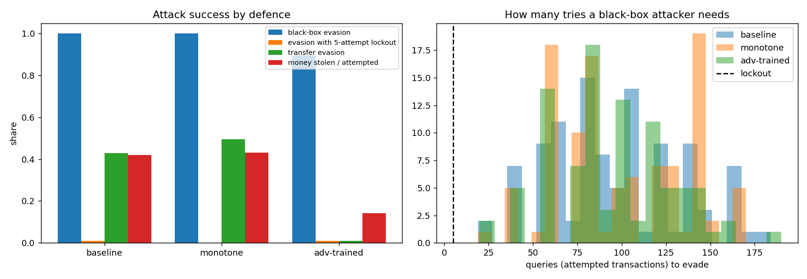

# Adversarial Fraud Lab

How easily can a fraudster holding a stolen card get past a bank's fraud model? Which defences actually help?

Most adversarial machine-learning work attacks images by changing pixels. Card fraud is different. The attacker cannot touch the model's features directly. They control a handful of real-world levers, each with a cost:

| Lever | Cost to the attacker |
|---|---|
| Steal a smaller amount (but not below what is worth the risk) | lower payout |
| Shop at a normal hour, at a low-risk merchant type | free |
| Slow down (fewer attempts per hour, longer gaps) | time (0.5) |
| Route through a VPN exit in the victim's country | 0.5 |
| Use a drop address matching the billing city | 1.5 |
| Use an aged email account bought online | 1.5 |
| Spoof the victim's device fingerprint | 2.0 |

Everything about the **victim's profile is immutable**: account age, usual spend, usual shopping hour. Features are always recomputed from raw fields, so every adversarial transaction is internally consistent. A ₹3,000 purchase on a card whose owner usually spends ₹1,300 still has a 2.3× amount ratio.

## Attacks

| Attack | What the attacker knows | Footprint |
|---|---|---|
| **Black-box greedy** | Only approve/decline answers from the bank. Picks the change with the biggest score drop per unit of effort, until approved. | Every query is a real attempted transaction |
| **Transfer** | Trains a surrogate model on their own data (outcomes of earlier campaigns), optimises against it offline, then submits **once** | One attempt |
| **Profit-seeking** | Transfer attack that starts at the full amount and steps down until the surrogate predicts approval | Maximises money stolen, not evasion |

## Defences

| Defence | Idea |
|---|---|
| **Monotone constraints** | XGBoost constrained so risk can never fall when a risk signal gets worse (new device, mismatched IP, younger email...) |
| **Adversarial training** | Attack the model with its own training frauds, add the evasions back as fraud, retrain (3 rounds), on top of the monotone model |
| **Card lockout** | Freeze the card after 5 declines. A black-box attacker no longer gets unlimited tries |

## Results

`python -m advlab evaluate`: 40,000 transactions, 105 caught stolen-card frauds attacked per model. Decline thresholds are set to a 1% false-positive rate.



| Model | PR-AUC | Recall @ 1% FPR | Black-box evasion | Evasion with 5-attempt lockout | Transfer evasion | Money stolen / attempted | Attacker effort |
|---|---|---|---|---|---|---|---|
| baseline | 0.999 | 1.000 | 100% (median 88 tries) | 1% | 43% | 42% | 1.4 |
| monotone | 0.999 | 1.000 | 100% (median 89 tries) | 0% | 50% | 43% | 1.1 |
| adversarially trained | 0.989 | 0.992 | 90% (median 95 tries) | 1% | **1%** | **14%** | **2.8** |

What this shows:

1. **A near-perfect clean model is not a secure one.** The baseline catches every fraud at a 1% false-positive rate, yet an attacker with unlimited tries beats it every time.
2. **Lockout is the cheapest, strongest control against probing.** Evasion needs about 88 attempts; after 5 declines the card is frozen, and success falls to 1%. Rate limits and lockouts belong in the fraud-ML threat model.
3. **The realistic attacker never probes.** They train their own model and try once. Against the baseline that works 43% of the time.
4. **Adversarial training is what stops them.** Offline evasion falls from 43% to 1%, stolen value from 42% to 14%, and the effort an attacker must spend doubles. It costs 0.010 PR-AUC on clean data.
5. **Monotone constraints alone did not help here.** Their value is that the model can be reasoned about and audited, not robustness. Stated plainly because it is the honest result.

The data is synthetic, so treat the numbers as a relative comparison between defences. The method transfers directly to a real model: plug it into `Scorer` and define the threat model for your channel.

## On real card fraud

`python -m advlab realdata --data creditcard.pq` repeats the attacks on the [ULB / Worldline card-fraud data](https://api.openml.org/d/1597): 284,807 real European card transactions, 492 frauds, 98 of them in the test split. Results are in `results/real_data.json`.

There, 28 of the 30 fields are anonymised PCA components. Nobody, attacker or bank, knows which real-world action moves them, so the threat model is narrower. The attacker can only change the **amount** (down to €1) and the **time of day**; everything else stays fixed.

| Model (decline at 1% FPR) | PR-AUC | Recall | Black-box evasion | With 5-try lockout | Transfer evasion | Value stolen |
|---|---|---|---|---|---|---|
| Baseline XGBoost | 0.838 | 88% | 3.5% (median 14 tries) | 1.2% | 1.2% | 3.3% |
| Adversarially trained | 0.838 | 88% | 3.5% | 1.2% | 1.2% | 3.3% |
| **Context-only** (amount and time removed) | 0.825 | 87% | **0%** | **0%** | **0%** | **0%** |

What the real data adds:
- **With only amount and timing to play with, evasion is rare**, because the anonymised behaviour components carry most of the signal. It isn't zero, though: a few frauds pass after about 14 tries.
- **Adversarial training had nothing to learn here.** None of the 246 training frauds could be pushed under the threshold, so no examples were added and the model is unchanged.
- **The robust fix is to not depend on attacker-controlled fields.** Dropping amount and time costs 0.013 PR-AUC and removes this attack surface entirely. Weigh that trade in your own setting, where the attacker usually controls more than two fields.

## Run it

```bash
pip install -r requirements.txt
python -m pytest -q                 # 5 tests
python -m advlab train              # defender models + attacker surrogate -> artifacts/
python -m advlab attack --index 3   # step-by-step attack on one transaction, every model
python -m advlab evaluate [--quick] # full benchmark -> results/
python -m advlab realdata --data creditcard.pq   # the attacks on real card fraud
streamlit run app.py                # attack studio
```

The **attack studio** works like this:
- Pick a stolen-card transaction, set the attacker's effort budget and minimum worthwhile amount, and toggle the lockout.
- Watch each model's fraud score fall step by step as the attacker changes the amount, then the hour, then buys an aged email, until it crosses the decline line or doesn't.

Example from `python -m advlab attack --index 3`, a ₹3,876 travel purchase on a new device through a foreign IP:

```
[baseline] black-box greedy: EVADED after 86 attempts, effort 2.0
   start                  -> None         score 1.000  (decline at 0.003)
   secs_since_last        -> 36000.0      score 1.000
   email_age_days         -> 1500.0       score 0.589
   velocity_1h            -> 0            score 0.042
   mcc                    -> grocery      score 0.002
   transfer attack: EVADED;  profit-seeking attacker gets ₹3,876 of ₹3,876

[adv-trained] black-box greedy: EVADED after 124 attempts, effort 4.0
   ...
   ship_bill_match        -> True         score 0.634  (decline at 0.665)
   transfer attack: caught;  profit-seeking attacker gets ₹0 of ₹3,876
```

Against the adversarially trained model the attacker has to spend their whole effort budget and 124 probing attempts. With the lockout they get 5. The offline attack that beat the baseline is caught.

## Using it on your own model

```python
from advlab.models import Scorer
from advlab.threat import ThreatModel
from advlab.attacks import greedy, transfer

scorer = Scorer("prod", your_model).calibrate(holdout_raw, holdout_labels, fpr=0.01)
result = greedy(scorer, raw_transaction_row, ThreatModel(min_amount=2000, budget=4))
```

Your model needs `predict_proba` over the features from `advlab.data.featurize`, or wrap your own featuriser. Then adjust `ThreatModel.costs` and `candidates` to match the levers your fraudsters actually have.

## Layout

```
advlab/
  data.py      raw stolen-card / genuine transactions and the featuriser
  threat.py    mutable vs immutable fields, attacker costs, feasible moves
  models.py    XGBoost (optionally monotone), attacker's MLP surrogate, threshold calibration
  attacks.py   black-box greedy, transfer, profit-seeking
  defenses.py  monotone model, adversarial training, lockout limit
  evaluate.py  benchmark and report
app.py         Streamlit attack studio
results/       last full benchmark
```
