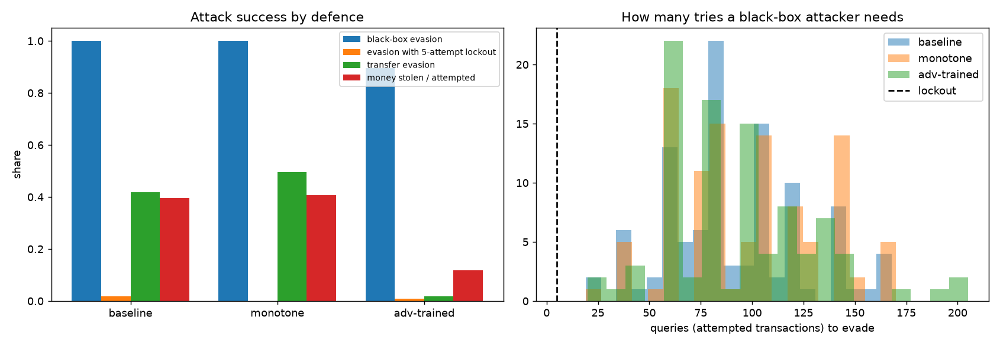

# Evaluation

## Simulated card transactions

`python -m advlab evaluate`: 40,000 transactions, with 105 caught stolen-card frauds attacked against each model. Decline thresholds are set at a 1% false-positive rate.



| Model | PR-AUC | Recall at 1% FPR | Black-box evasion | With 5-attempt lockout | Transfer evasion | Money stolen / attempted | Attacker effort |
|---|---|---|---|---|---|---|---|
| Baseline | 0.999 | 1.000 | 100% (median 84 tries) | 2% | 42% | 40% | 1.4 |
| Monotone | 0.999 | 1.000 | 100% (median 95 tries) | 0% | 50% | 41% | 1.1 |
| Adversarially trained | 0.990 | 0.988 | 90% (median 85 tries) | 1% | 2% | 12% | 2.7 |

- A model that is nearly perfect on clean data can still be beaten: with unlimited tries, an attacker gets past the baseline every time.
- Freezing the card after 5 declines is the cheapest and strongest control against probing, because evasion needs 84–95 attempts.
- A realistic attacker trains their own model and tries once. Against the baseline that works 42% of the time.
- Adversarial training cuts that to 2% and the money stolen from 40% to 12%, for a 0.009 drop in clean PR-AUC.
- Monotone constraints didn't improve robustness here; their value is that the model is easier to reason about and audit.

The data is synthetic, so read these as a comparison between defences rather than absolute rates. These numbers are from a re-run on the pinned dependencies (xgboost 3.4, torch 2.15); the first run, on older versions, gave the same picture with slightly different values (for example 43% and 1% transfer evasion). The example trace below is from that first run.

Example from `python -m advlab attack --index 3`, a ₹3,876 travel purchase on a new device through a foreign IP:

```
[baseline] black-box greedy: EVADED after 86 attempts, effort 2.0
   start                  -> None         score 1.000  (decline at 0.003)
   secs_since_last        -> 36000.0      score 1.000
   email_age_days         -> 1500.0       score 0.589
   velocity_1h            -> 0            score 0.042
   mcc                    -> grocery      score 0.002
   transfer attack: EVADED;  profit-seeking attacker gets ₹3,876 of ₹3,876

[adv-trained] black-box greedy: EVADED after 124 attempts, effort 4.0
   ...
   ship_bill_match        -> True         score 0.634  (decline at 0.665)
   transfer attack: caught;  profit-seeking attacker gets ₹0 of ₹3,876
```

## Real card fraud

`python -m advlab realdata --data creditcard.pq` repeats the attacks on the [ULB / Worldline card-fraud data](https://api.openml.org/d/1597): 284,807 real European card transactions with 492 frauds, 98 of them in the test split. Results go to `results/real_data.json`.

In this data, 28 of the 30 fields are anonymised components, and nobody knows which real-world action moves them. The attacker can therefore only change the amount (down to €1) and the time of day.

| Model (decline at 1% FPR) | PR-AUC | Recall | Black-box evasion | With 5-try lockout | Transfer evasion | Value stolen |
|---|---|---|---|---|---|---|
| Baseline XGBoost | 0.838 | 88% | 3.5% (median 14 tries) | 1.2% | 1.2% | 3.3% |
| Adversarially trained | 0.838 | 88% | 3.5% | 1.2% | 1.2% | 3.3% |
| Without amount and time | 0.825 | 87% | 0% | 0% | 0% | 0% |

With only amount and timing to change, evasion is rare because the anonymised fields carry most of the signal, but a few frauds still pass after about 14 tries. Adversarial training had nothing to learn: none of the 246 training frauds could be pushed under the threshold, so the model is unchanged. Dropping the two fields the attacker controls costs 0.013 PR-AUC and removes this attack completely. In practice attackers usually control more than two fields, so that trade-off has to be weighed per channel.
